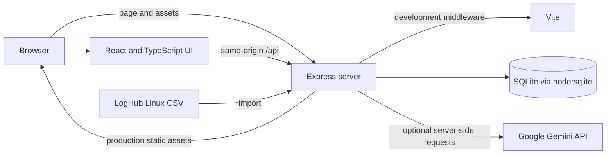

# IncidentIQ

IncidentIQ is an incident memory and investigation-support platform designed to help operations teams retrieve relevant historical incidents, examine supporting evidence, and learn from previously recorded investigation outcomes.

*Learn from every incident. Resolve the next one smarter.*

Team Zenvora's submission to the IBM Z Datathon 2026, **Wildcard — Beyond the Obvious**.

## Overview

Operational teams need more than incident dashboards: they need a way to retain investigation context, relate new symptoms to prior cases, and review what actions were recorded as successful, failed, or inconclusive. IncidentIQ combines incident records, investigation history, log references, and human-reviewed resolution notes in one application.

The project is designed for IBM Z and LinuxONE operations scenarios. It is not connected to live IBM Z systems. Its included Linux logs and incident records are demonstration data.

## Key capabilities

- Register incidents with severity, category, affected system, and reporter details; manage lifecycle status and resolution outcomes.
- Find stored incidents using keyword-frequency cosine similarity, with percentages, matched terms, and qualitative labels.
- Search the included Linux log dataset by message text, component, event ID, month, day, and time; link source lines to incidents with a reason.
- Record investigation actions and outcomes, including supporting log-line references.
- Claim unassigned work, assign or reassign analysts, and review escalation requests through manager workflows.
- Review stored audit events, notifications, analyst workload, incident trends, and operational analytics; export analytics as CSV or JSON.
- Use optional Gemini-assisted chat and recommendations, with rule-based responses when AI is not configured or unavailable.

Similarity, stored procedures, and recorded outcomes are investigation references for people to review. They do not establish that a past remediation will work in a new environment.

## How It Works

1. **Register an Incident** — A reporter or analyst records the incident, including its observed symptoms and affected system.

2. **Search Incident Memory** — The analyst searches previously recorded incidents to find similar cases and review their investigation history and outcomes.

3. **Search Sample Logs** — The analyst searches the LogHub Linux sample logs for relevant log entries.

4. **Link Evidence** — Relevant source log lines are linked to the incident to support the investigation.

5. **Record Investigation Actions** — The analyst documents the actions taken and their outcomes.

6. **Resolve or Escalate** — The analyst records the resolution outcome or requests escalation when manager review is needed.

7. **Review Incident History** — Teams can review stored incident details, linked evidence, investigation history, audit trail, and analytics.

## Architecture

The root npm scripts start the Express application in [server.ts](./server.ts). It serves the React interface through Vite middleware during development and serves the prebuilt `dist` assets in production. The browser calls the same-origin `/api` routes. The Express API accesses the persistent SQLite database through Node's built-in `node:sqlite` module. The included CSV can be imported into the log table and searched through the API.

When a server-side `GEMINI_API_KEY` is configured, the application can call Gemini for chat and recommendations. The recommendation flow supplies linked log evidence and recorded investigation actions where available. Chat's Gemini prompt includes a limited list of recent incidents; it is not a general retrieval service for every database record.



The repository also contains a separate Flask implementation under `backend/`. The root `npm run dev` and `npm run start` scripts use the Express server; this README's setup instructions describe that path.

## Technology stack

| Layer | Technology | Responsibility |
|---|---|---|
| User interface | React, TypeScript | Application views, incident workflows, and typed client code |
| Frontend build and development | Vite, `@vitejs/plugin-react` | Development middleware and production asset build |
| Styling and visuals | Tailwind CSS, Lucide React, Three.js | Utility styling, interface icons, and the workflow visualization |
| API server | Node.js, Express, TypeScript via `tsx` | HTTP API, development/production serving, and server-side integrations |
| Persistence | SQLite through Node's `node:sqlite` | Incident, log, investigation, assignment, audit, and related records |
| Optional AI | Google Gemini through `@google/genai` | AI-assisted chat and recommendations when configured |
| Configuration | dotenv | Load server environment variables from `.env` |

The package declares Node.js `>=22.13.0`. The root npm scripts and `package-lock.json` are used in the setup below. A `bun.lock` file is also present, but Bun is not documented as a supported runtime for this application.

## Data model

The SQLite schema stores:

- **Users and incidents** — demo user profiles, incident descriptions, status, severity, ownership, and resolution fields.
- **Investigation actions** — analyst, action description, outcome, notes, and JSON-encoded source-line references.
- **Logs and evidence links** — imported log fields indexed by original `LineId`; incident links retain the source line and a human-entered matching reason.
- **Assignments and escalations** — assignment history and escalation requests, including manager decisions.
- **Resolution knowledge** — stored symptoms, procedures, outcomes, and recorded caveats.
- **Collaboration and operations** — comments, notifications, and audit events.

The supplied `data/incidentiq.sqlite` contains application records and is used by default. The `data/Linux_2k.log_structured.csv` file is imported as log data when the database is first seeded; the Log Explorer also provides dataset import. Startup applies additive schema migrations. Keep the SQLite file when updating the application.

Seeded incidents, knowledge entries, and audit rows are marked as demo data. Built-in role-switcher identities are synthetic. The audit trail is stored in SQLite and is not immutable or tamper-proof. Reuse events and independent knowledge verifications are not recorded as separate records.

## Installation

### Prerequisites

- Windows PowerShell
- Node.js 22.13.0 or newer, with npm
- Git

### Clone and run

```powershell
git clone https://github.com/sathvika32427/IncidentIQ-ibmz.git
Set-Location .\IncidentIQ-ibmz
npm ci

# Keep the development server local to this machine.
$env:HOST = '127.0.0.1'
$env:PORT = '3000'
npm run dev
```

Open [http://localhost:3000](http://localhost:3000). The default server port is `3000`. Development binds to `0.0.0.0` unless `HOST` is set, so the commands above explicitly limit access to the local machine.

The included `data/incidentiq.sqlite` is the default database. If the file is absent, the application initializes the schema and seeds the demo records; the bundled CSV is ingested during initial seeding. Do not delete or replace an existing database to troubleshoot startup.

## Configuration

The server loads `.env` from the project working directory. The repository's `.gitignore` excludes `.env` and other `.env.*` files. If `.env` already exists, edit it without replacing its contents.

| Variable | Purpose | Default / required |
|---|---|---|
| `PORT` | HTTP server port | `3000`; optional |
| `HOST` | HTTP bind address | Development: `0.0.0.0`; production: `127.0.0.1`; optional |
| `NODE_ENV` | Select development middleware or production static serving | Development unless set to `production`; optional |
| `INCIDENTIQ_DB_PATH` | SQLite database file path | `data/incidentiq.sqlite`; optional |
| `INCIDENTIQ_API_TOKEN` | Shared server-to-server token required by the API gateway | Unset for local use; required on the proxied production backend |
| `GEMINI_API_KEY` | Server-side credential for Gemini chat and recommendations | Optional; AI features are unavailable without it |

For local development, create `.env` only if it does not already exist, then edit it:

```powershell
if (-not (Test-Path .env)) { New-Item -ItemType File .env | Out-Null }
notepad .env
```

Example settings (do not add a real key to source control):

```dotenv
PORT=3000
HOST=127.0.0.1
NODE_ENV=development
# GEMINI_API_KEY=<set privately if Gemini is required>
# INCIDENTIQ_DB_PATH=<optional absolute path to a persistent SQLite file>
# INCIDENTIQ_API_TOKEN=<set privately on the proxied production backend>
```

The key is read by the server and must not be placed in frontend code or committed to Git.

## Usage

1. Open **Overview** to review incident counts and database-backed analytics.
2. Use **New Incident** to register a report and inspect it in **Incidents**.
3. Open **Similar Incident Search** to compare stored descriptions and review matching terms, scores, and labels.
4. Open **Log Explorer** to search the included CSV data or import a CSV. Select a relevant line to link it to an incident with a reason.
5. In an incident detail, review linked log messages and record investigation actions with outcomes: `In Progress`, `Successful`, `Failed`, or `Inconclusive`.
6. Analysts can claim unassigned incidents. Managers can assign analysts and review escalation requests in **Escalation Queue**.
7. Record the incident resolution outcome separately from investigation-action outcomes. Review history in **Investigation History**, **Knowledge Base**, and **Audit Trail**.

## Data sources

The bundled [Linux_2k.log_structured.csv](./data/Linux_2k.log_structured.csv) is from the [LogHub Linux 2k dataset](https://github.com/logpai/loghub). Its fields are `LineId`, `Month`, `Date`, `Time`, `Level`, `Component`, `PID`, `Content`, `EventId`, and `EventTemplate`. The source contains month, day, and time values, but no year.

These are Linux benchmark sample logs for demonstration and investigation. They are not verified IBM Z production telemetry and are not streamed from a live system. Seeded incident narratives, investigation outcomes, and built-in users are synthetic demonstration content; linked log records retain the CSV's source line identifiers.

## AI integration

The optional Gemini integration uses the `gemini-2.5-flash` model for chat and recommendations. The server checks whether Gemini responds and reports unconfigured, unverified, available, or unavailable status.

Without `GEMINI_API_KEY`, the application continues in rule-based mode and labels responses as not AI-generated. Failed Gemini requests also return a rule-based fallback with an explicit warning. The API key remains server-side. AI is not used for every application feature.

## Security and access control

IncidentIQ has a demonstration role switcher, not user authentication. The selected demo user ID is supplied by the client. The API applies role checks to selected write operations and ownership checks for analyst work, but these checks do not establish a trusted user identity.

Do not expose this application to untrusted networks or use the demo roles as production authorization. Use a protected environment file for secrets, bind to loopback when appropriate, and add real authentication and deployment access controls before any public or operational use. Audit events are ordinary SQLite records, not tamper-proof logs.

## Testing and validation

The root package scripts provide:

```powershell
npm run lint   # TypeScript check (tsc --noEmit)
npm run build  # Vite production frontend build
```

There is no project-level automated test script or checked-in test suite in the root package. These commands do not verify LinuxONE compatibility or a remote deployment.

## Deployment

Vercel hosts the Vite frontend and the `/api/*` Vercel function in [api/[...path].ts](./api/[...path].ts) forwards API requests to the existing Express server. The Express server must run separately on a host with persistent storage. Vercel's function filesystem is not the application's persistent SQLite database; do not run the SQLite application database inside a Vercel function.

### Configure the persistent Express backend

Deploy the repository's existing Node/Express application on a VM or another service that provides durable disk storage. Keep `data/Linux_2k.log_structured.csv` in the release directory. Use Node.js `>=22.13.0`. Configure a persistent database path outside disposable release directories. If starting with an empty database, `initDatabase()` seeds the demo users, four demo incidents, associated investigation/escalation records, and imports the bundled CSV. Existing SQLite files are not reset; preserve and back them up.

```bash
# On the backend host, from the deployed project directory:
node --version
command -v node
npm ci
npm run build
```

Create the service account if it does not already exist, make the persistent directories, and ensure the service account owns the deployed project and its `node_modules`. Create a protected backend environment file readable only by that account. Keep the API server on loopback behind an HTTPS reverse proxy:

```dotenv
NODE_ENV=production
HOST=127.0.0.1
PORT=3000
INCIDENTIQ_DB_PATH=/var/lib/incidentiq/incidentiq.sqlite
INCIDENTIQ_API_TOKEN=<same random secret configured in Vercel>
```

```bash
# Backend host: create the account only if needed; do not replace an existing database.
id incidentiq >/dev/null 2>&1 || sudo useradd --system --home-dir /opt/incidentiq --shell /usr/sbin/nologin incidentiq
sudo install -d -o incidentiq -g incidentiq -m 0750 /opt/incidentiq/app
sudo install -d -o incidentiq -g incidentiq -m 0750 /var/lib/incidentiq
sudo install -d -o root -g incidentiq -m 0750 /etc/incidentiq
sudoedit /etc/incidentiq/incidentiq.env
sudo chmod 0640 /etc/incidentiq/incidentiq.env

# Create a systemd unit. Replace /usr/bin/node with the path printed by command -v node.
sudo tee /etc/systemd/system/incidentiq-api.service <<'UNIT'
[Unit]
Description=IncidentIQ Express API
After=network.target

[Service]
Type=simple
User=incidentiq
Group=incidentiq
WorkingDirectory=/opt/incidentiq/app
EnvironmentFile=/etc/incidentiq/incidentiq.env
ExecStart=/usr/bin/node /opt/incidentiq/app/node_modules/tsx/dist/cli.mjs server.ts
Restart=on-failure
RestartSec=5
ProtectSystem=strict
ReadWritePaths=/var/lib/incidentiq

[Install]
WantedBy=multi-user.target
UNIT
sudo systemctl daemon-reload
sudo systemctl enable --now incidentiq-api
sudo systemctl status incidentiq-api --no-pager
```

If the database path does not exist, SQLite creates it on startup and the application seeds its demo records. If a database already exists at the selected path, keep it; do not copy over or delete it. Back it up before upgrades.

Verify the backend directly from its host before connecting Vercel. Since the production API token is enabled, include it in the request header; do not paste the real token into shell history:

```bash
read -rsp 'IncidentIQ API token: ' INCIDENTIQ_API_TOKEN; echo
curl -fsS -H "x-incidentiq-api-token: $INCIDENTIQ_API_TOKEN" http://127.0.0.1:3000/api/health
curl -fsS -H "x-incidentiq-api-token: $INCIDENTIQ_API_TOKEN" http://127.0.0.1:3000/api/incidents
curl -fsS -H "x-incidentiq-api-token: $INCIDENTIQ_API_TOKEN" http://127.0.0.1:3000/api/analytics/overview
unset INCIDENTIQ_API_TOKEN
```

Inspect service logs with `sudo journalctl -u incidentiq-api -n 100 --no-pager`; restart after a failure with `sudo systemctl restart incidentiq-api`.

`/api/health` should report `healthy`. The API's analytics and incident listing query the configured SQLite database.

### Configure and deploy the Vercel frontend

Set these **server-side Vercel Project Environment Variables** for Production and Preview as appropriate:

| Variable | Value |
|---|---|
| `INCIDENTIQ_API_ORIGIN` | The HTTPS origin of the Express backend, for example `https://incidentiq-api.example.com` (no `/api` suffix) |
| `INCIDENTIQ_API_TOKEN` | A high-entropy random secret; set the identical value in the backend environment file |

The Vercel function forwards each `/api/...` request, including its method, query string, and request body, to the configured origin, and adds the shared token as a server-to-server header. The Express server checks that token when it is configured. The token is not embedded in the React bundle. Do not expose it in a `VITE_*` variable. Configure the backend origin with HTTPS and do not make the SQLite file itself public.

Then deploy from the repository root:

```bash
npm ci
npm run lint
npm run build
npx vercel --prod
```

The deployment configuration in [vercel.json](./vercel.json) builds the Vite frontend to `dist`; Vercel discovers the API function under `api/`. After deployment, check `https://<your-vercel-domain>/api/health`, `https://<your-vercel-domain>/api/incidents`, and `https://<your-vercel-domain>/api/analytics/overview`. The health endpoint must return `healthy`, and incident/analytics data should correspond to the persistent backend database.

Vercel alone cannot provide durable persistence for this SQLite application. If no separate backend with persistent storage is configured, the proxy returns `503` with a configuration error rather than presenting an empty dashboard. The frontend cannot create durable incident records until both Vercel variables are set and the Express backend is reachable.

The existing application has not been deployed or verified on Vercel or LinuxONE in this change. IBM LinuxONE remains an intended target; confirm the host OS, architecture, Node.js/SQLite runtime, and remote health response on the target before claiming support.

## Limitations and possible next steps

- Similarity is a keyword-frequency cosine calculation, not machine learning; the percentage measures textual similarity only.
- Included incidents, users, and knowledge examples contain synthetic/demo records. LogHub data is not live or IBM Z production telemetry.
- There is no real authentication, and the database audit trail has no tamper protection.
- Gemini is optional and can be unavailable; rule-based functionality is the fallback.
- LinuxONE/s390x deployment and runtime compatibility have not been verified.
- Potential follow-up work includes adding authenticated identities, a maintained automated test suite, and a verified LinuxONE deployment workflow. These are not implemented capabilities.

## Project information

| | |
|---|---|
| Project | IncidentIQ |
| Team | Zenvora |
| Event | IBM Z Datathon 2026 |
| Challenge | Wildcard — Beyond the Obvious |
| Repository | [sathvika32427/IncidentIQ-ibmz](https://github.com/sathvika32427/IncidentIQ-ibmz) |
